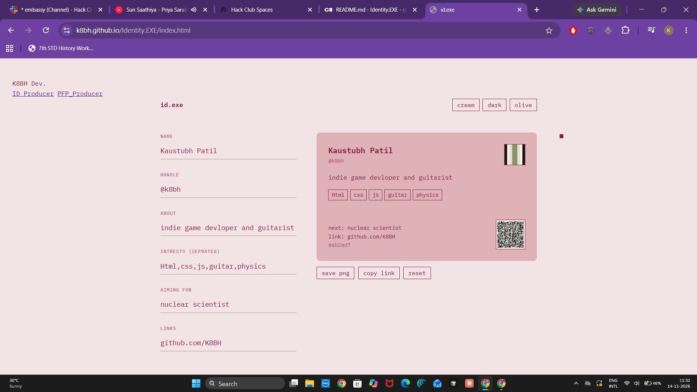
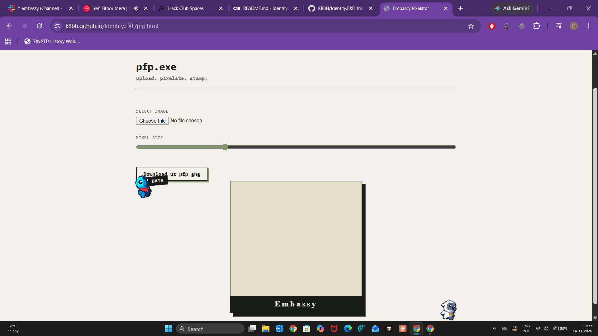

# Identity.EXE

> Digital ID Generator and pfp pixalator
## // What is This??

Most profiles are just boring, flat boxes. Identity.EXE takes ur inputs, trait spectrums, and core tags and converts them into a unique **8x8 Cryptographic Identity Matrix**.

Instead of just saving text to a database, this engine instantly binds your data to UI. It features a custom pixel avatar generator, a live QR verification link, and exports the final result as high-resolution PNG identity Card. (not really high resolution but it works :3).

## // Main Highlight!- PFP.EXE

This is the Main Highlight of my Website **pfp.exe Embassy Pixalator**. Upload any image, tweak the custom pixelation slider, drop some retro stamps, and genrate a matching pixel-art avatar right from the navbar.

